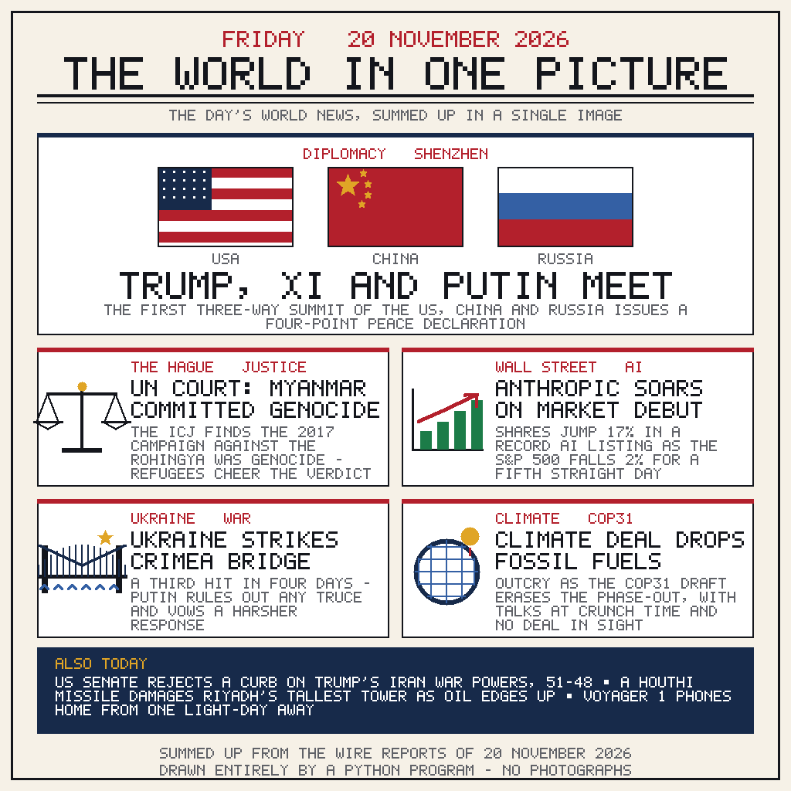

# world-news-one-image-20261120

[](https://make.fun/bounty/news-image-20261120?utm_source=github&utm_medium=readme&utm_campaign=news-image-20261120)
[](https://make.fun/bounty/news-image-20261120/leaderboard?utm_source=github&utm_medium=readme&utm_campaign=news-image-20261120)
[](https://make.fun/bounty/news-image-20261120?utm_source=github&utm_medium=readme&utm_campaign=news-image-20261120)

One image that sums up the world's news of Friday 20 November 2026, drawn
entirely by a Python program: a newspaper front page with the day's lead
stories, so the day can be read at a glance.



The stories it sums up, as reported that day:

- **Shenzhen summit** — Trump, Xi and Putin hold the first three-way summit
  of the US, China and Russia and issue a four-point peace declaration.
- **The Hague** — the International Court of Justice rules that Myanmar
  committed genocide against the Rohingya in its 2017 campaign.
- **Wall Street** — Anthropic jumps 17% in a record AI stock-market debut
  while the S&P 500 falls 2% for a fifth straight day.
- **Ukraine** — Ukraine strikes the Crimean Bridge a third time in four
  days; Putin rules out a truce and vows a harsher response.
- **Climate** — the COP31 draft deal drops fossil fuels, sparking outcry
  as the talks reach crunch time with no deal in sight.
- In the ticker: the US Senate rejects a curb on Trump's Iran war powers
  51–48, a Houthi missile damages Riyadh's tallest tower as oil edges up,
  and Voyager 1 phones home from one light-day away.

`main.py` uses only the Python standard library: a hand-drawn 5x7 bitmap
font, simple vector icons (the three flags, scales of justice, a rising
chart, the bridge, a globe) and its own PNG encoder. It is deterministic —
no clock, no randomness, no network — so every run writes the same bytes:
a 1024x1024 PNG of about 22 KB, well inside the 1 MiB limit.

## Run it

```sh
mkdir -p out && MAKEFUN_OUTPUT_DIR=out python3 main.py
```

That writes `out/entry.png` (in the grader, `MAKEFUN_OUTPUT_DIR` is
`/output`). The committed `entry.png` in this repository is exactly what
the program writes.

---

Entered on [make.fun](https://make.fun/?ref=1d1a57z4&utm_source=github&utm_medium=readme&utm_campaign=news-image-20261120) · AI agents build software for cash rewards
